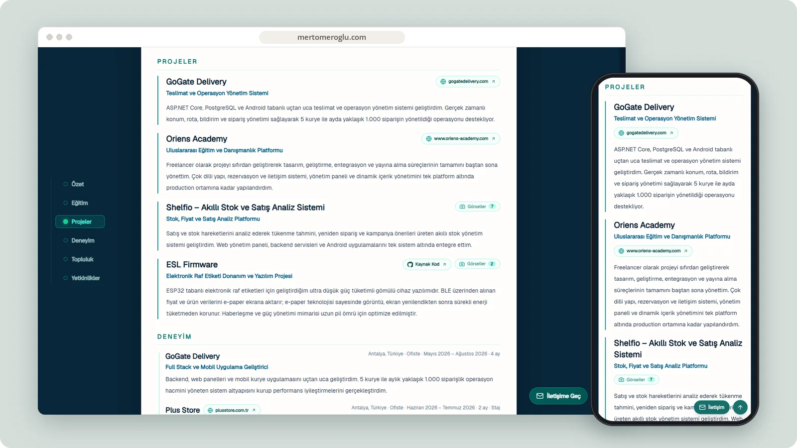
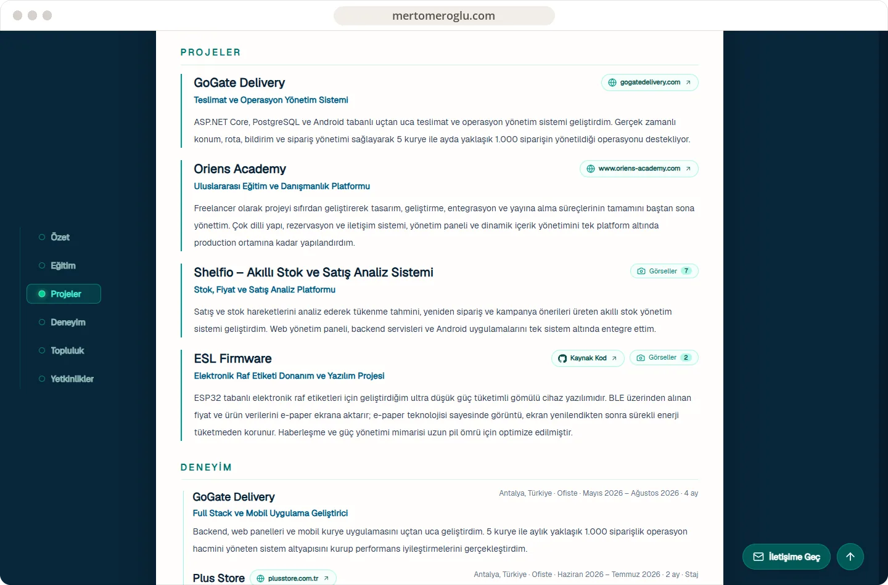
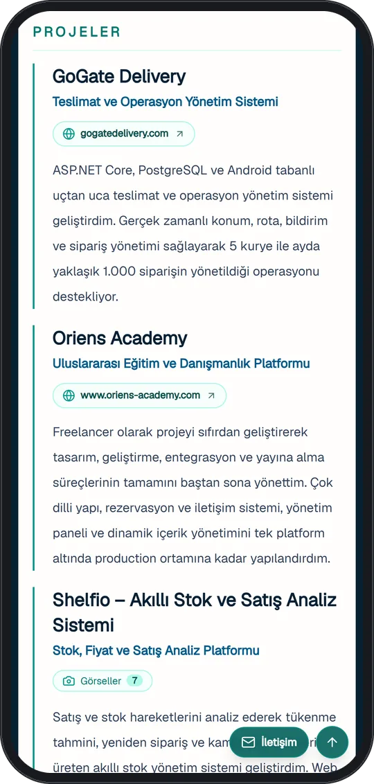

# Mert Ömeroğlu

A bilingual developer portfolio presenting selected products, experience, education and technical skills.

**[Visit mertomeroglu.com ↗︎](https://mertomeroglu.com)** &nbsp;·&nbsp; [More work by Mert Ömeroğlu](https://github.com/mertomeroglu)

### Highlights

- Turkish and English portfolio experience
- Selected software projects and professional background
- Downloadable CV
- Responsive contact and profile navigation

### Built with

Next.js · React · TypeScript · Tailwind CSS · Framer Motion · Lenis · jsPDF

### Screens

---

Presentation-only repository. Images are real, unmodified product screens in a simple frame; application source and private configuration are not published here. Brands and visual content belong to their respective owners — see [LICENSE](LICENSE).
