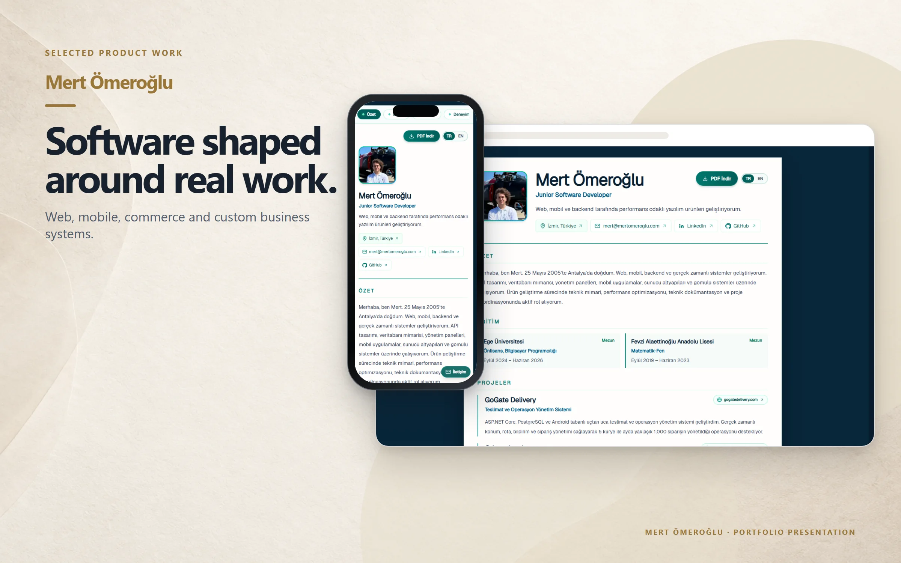
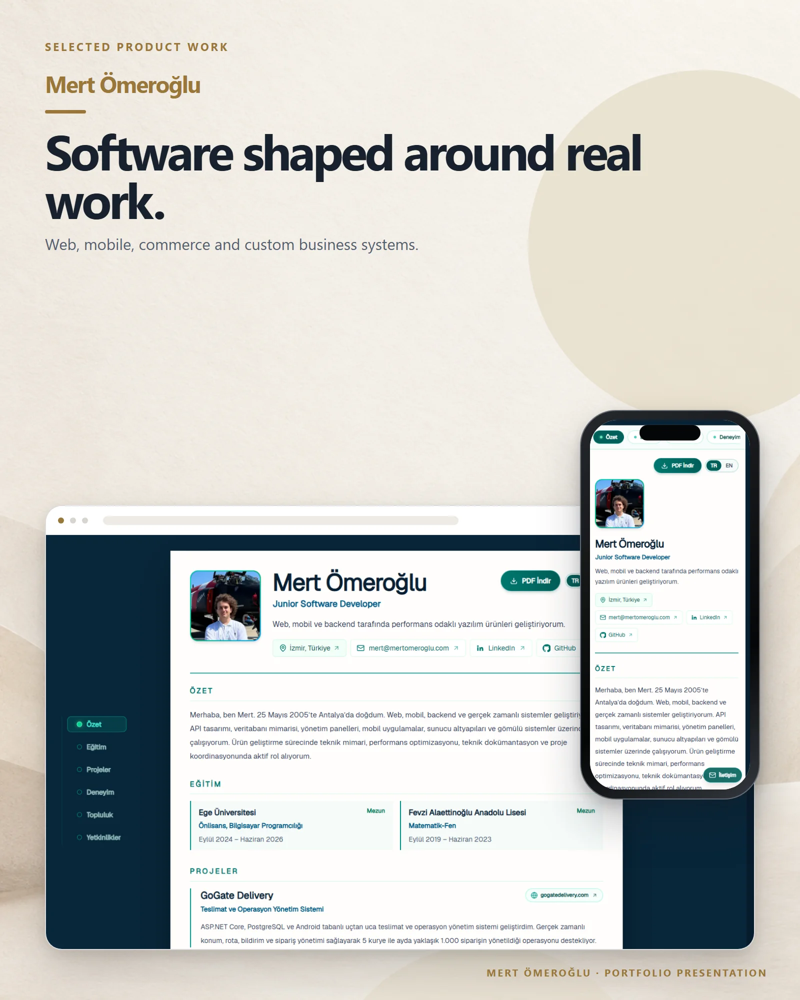

# Mert Ömeroğlu

A bilingual developer portfolio presenting selected products, experience, education and technical skills.

**Live:** [mertomeroglu.com](https://mertomeroglu.com) &nbsp;·&nbsp; **More work:** [github.com/mertomeroglu](https://github.com/mertomeroglu)

### Highlights

- Turkish and English portfolio experience
- Selected software projects and professional background
- Downloadable CV
- Responsive contact and profile navigation

### Built with

Next.js · React · TypeScript · Tailwind CSS · Framer Motion · Lenis · jsPDF

---

Presentation-only repository: this README and two presentation images built from real product screens. Application source and private configuration are not published here. Visual content and brand assets remain the property of their respective owners — see [LICENSE](LICENSE).
